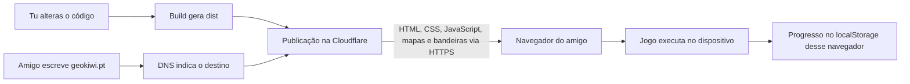

# Publicar o GeoKiwi no Cloudflare Pages

Projeto já criado na conta autorizada: `geokiwi`, com endereço `https://geokiwi.pages.dev`. O domínio `geokiwi.pt` ainda tem de ser comprado e associado. Para atualizar este projeto, usa apenas `npm run cloudflare:deploy` após o login; não é necessário repetir a criação.

O projeto está preparado para alojamento estático. Não precisa de servidor próprio, base de dados, conta OpenAI dos jogadores ou computador ligado em casa. A compra do domínio e a criação da conta Cloudflare são feitas por ti. Nada neste documento afirma que o domínio já foi comprado ou ligado.

## Opção mais simples: carregar o ZIP

1. Cria uma conta em https://dash.cloudflare.com/ e escolhe o plano gratuito.
2. Abre **Workers & Pages**, cria uma aplicação **Pages** e escolhe **Direct Upload / carregar ficheiros**. Os nomes no painel podem variar; escolhe Pages, não um Worker.
3. Dá ao projeto o nome `geokiwi` se estiver disponível. Se não estiver, escolhe outro e usa esse nome nos comandos de publicação.
4. Carrega `releases/geokiwi-cloudflare-pages.zip`. O `index.html` está na raiz do ZIP. Publica.
5. Abre o endereço `*.pages.dev` devolvido pelo painel. Esse é o endereço real; não assumas que `geokiwi.pages.dev` está disponível.
6. Envia o endereço ao teu amigo. Não é necessário manter o Terminal ou o Codex aberto.

O ZIP é uma fotografia do jogo na data em que foi gerado. Alterar o código no computador ou no Codex não atualiza a Cloudflare: é necessário publicar uma nova versão. Direct Upload não pode ser convertido em integração Git no mesmo projeto; se quiseres atualizações automáticas a partir de GitHub, escolhe a integração Git logo na criação ou cria outro projeto mais tarde.

## Ligar geokiwi.pt após a compra

1. Na Cloudflare, adiciona o domínio `geokiwi.pt` à tua conta com o plano Free. Não é necessário transferir a compra do domínio para a Cloudflare.
2. A Cloudflare mostra os servidores DNS atribuídos à tua conta. No painel da empresa onde compraste o domínio, substitui os nameservers pelos valores exatos indicados. Não inventes nem copies os de outra conta.
3. Espera que a Cloudflare confirme o domínio como ativo.
4. No projeto Pages, abre **Custom domains → Set up a domain** e adiciona `geokiwi.pt`. Adiciona `www.geokiwi.pt` se também o quiseres usar.
5. Segue os registos sugeridos pelo painel e espera que o domínio e o certificado HTTPS fiquem ativos. Abre `https://geokiwi.pt` para verificar.

Usa sempre o mesmo endereço para jogar: os progressos de `www.geokiwi.pt`, `geokiwi.pt`, `*.pages.dev` e do antigo site são independentes. Depois de ambos os nomes estarem ativos, é possível configurar na Cloudflare um redirecionamento de `www` para o domínio principal. Não foi adicionado um redirecionamento antecipado para um domínio que ainda não está ativo.

## Atualizar pelo Terminal

Requisitos: Node.js 22.13+ e as dependências do projeto. O projeto usa pnpm 11.25.0. Os scripts usam uma versão fixa do Wrangler (CLI oficial da Cloudflare), descarregada pelo npm na primeira utilização.

```sh
cd /Users/tmustra/Documents/Codex/geokiwi-recovered
npx pnpm@11.25.0 install
npm run cloudflare:login
```

O login abre o navegador para autorizares a tua conta. Não coloques tokens no código ou no chat.

Se o projeto Pages ainda não existir, cria-o uma única vez:

```sh
npm run cloudflare:create
```

Publicar ou atualizar (se o projeto se chamar `geokiwi`):

```sh
npm run cloudflare:deploy
```

O comando constrói o jogo e envia `dist/` à Cloudflare, na branch de produção `main`. Se escolheres outro nome, atualiza `wrangler.toml` e os scripts `cloudflare:create`/`cloudflare:deploy` no `package.json`. O domínio é ligado separadamente no painel; não está embutido no jogo.

Para gerar um novo ZIP em vez de publicar:

```sh
npm run cloudflare:package
```

Não carregues `node_modules`, `.git`, credenciais, código-fonte ou o arquivo `.tar.gz` preparado para o Sites. O ZIP de Pages contém apenas a versão final do jogo e as licenças dos dados.

## Onde ficam as informações



- **Código-fonte:** guardado no teu projeto e no repositório associado ao Sites. O ZIP de código-fonte é uma cópia de segurança, não uma sincronização automática com a Cloudflare.
- **Ficheiros públicos:** a Cloudflare guarda e distribui HTML, CSS, JavaScript, mapas, fontes e bandeiras. Como em qualquer site de frontend, os visitantes podem descarregar esses ficheiros.
- **Domínio:** a empresa onde o compras mantém o registo e a renovação. O DNS diz aos navegadores onde encontrar o site; não guarda o jogo nem os progressos.
- **Partidas, pontuação e preferências:** ficam no localStorage do navegador de cada jogador. O código atual não envia esses progressos para uma base de dados na Cloudflare. Limpar dados do navegador pode apagá-los. Mudar de navegador, dispositivo ou domínio começa outro armazenamento.
- **Pedidos de acesso:** a Cloudflare processa os pedidos e os metadados técnicos habituais da ligação, como o IP. Isso é distinto do progresso do jogo; não foi acrescentada analítica ao projeto.
- **Codex:** ajuda a editar e preparar o código. O teu amigo não precisa de Codex para jogar a versão publicada no Pages.

## Verificar após publicar

Testa `*.pages.dev` e, depois de ligado, `geokiwi.pt`: Home, um jogo de países, bandeiras, mapa detalhado, concelhos/distritos, estados e capitais. Confirma que recarregar a página permite retomar uma partida. Verifica o acesso numa janela privada sem iniciar sessão no Codex.

## Fontes oficiais

- Publicação por ZIP/CLI: https://developers.cloudflare.com/pages/get-started/direct-upload/
- Domínios e nameservers: https://developers.cloudflare.com/pages/configuration/custom-domains/
- Configuração Wrangler: https://developers.cloudflare.com/pages/functions/wrangler-configuration/
- Pedidos estáticos gratuitos: https://developers.cloudflare.com/pages/functions/pricing/
